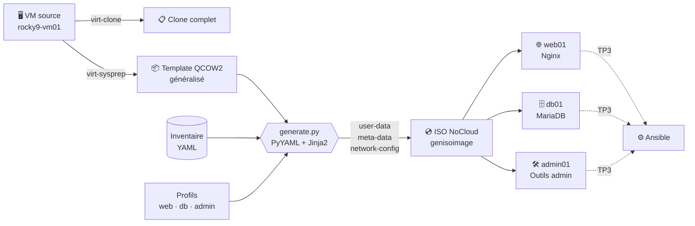

<div align="center">

# ☁️ Virtualisation & Cloud Computing

### De la VM manuelle à l'infrastructure automatisée : KVM/QEMU · Cloud-Init · Jinja2 · Ansible


*Une infrastructure virtualisée complète, reproductible et pilotée par le code.*

</div>

---

## 📑 Sommaire

- [🎯 Vision du projet](#-vision-du-projet)
- [🏗️ Architecture globale](#️-architecture-globale)
- [🧰 Stack technique](#-stack-technique)
- [📂 Structure du dépôt](#-structure-du-dépôt)
- [💻 TP1 : Virtualisation KVM/QEMU](#-tp1--virtualisation-kvmqemu)
- [☁️ TP2 : Industrialisation avec Cloud-Init & Jinja2](#️-tp2--industrialisation-avec-cloud-init--jinja2)
- [🔧 TP3 : Ansible](#-tp3--ansible)
- [🚀 Démarrage rapide](#-démarrage-rapide)
- [⚙️ Prérequis : virtualisation imbriquée](#️-prérequis--virtualisation-imbriquée)
- [👤 Auteur](#-auteur)

---

## 🎯 Vision du projet

Ce dépôt rassemble les travaux pratiques du cours **Virtualisation et Cloud Computing**. Il suit une progression volontaire, celle d'un ingénieur infrastructure moderne :

> **Créer** une VM à la main → **Comprendre** son identité → **Généraliser** en template → **Déployer** des machines à la chaîne → **Configurer** en continu.

L'objectif final : passer d'une administration manuelle à une approche **Infrastructure as Code**, où chaque machine est décrite, versionnée et reproductible en une commande.

---

## 🏗️ Architecture globale



**Principe clé du TP2 : séparer trois responsabilités**

| Couche | Rôle | Outil |
|---|---|---|
| 📊 **Données** | Qui sont mes machines ? | Inventaire YAML |
| 🧠 **Logique** | Comment les décrire ? | Templates Jinja2 |
| ⚡ **Exécution** | Que faire au premier boot ? | Cloud-Init |

---

## 🧰 Stack technique

| Domaine | Technologies |
|---|---|
| **Hyperviseur** | KVM, QEMU, libvirt |
| **Système invité** | Rocky Linux 9 |
| **Outils VM** | `virsh`, `virt-install`, `virt-clone`, `virt-sysprep`, `guestfs-tools` |
| **Format disque** | QCOW2 |
| **Provisioning** | Cloud-Init (datasource NoCloud), `genisoimage` |
| **Automatisation** | Python 3, PyYAML, Jinja2, Bash |
| **Configuration** | Ansible *(en cours)* |

---

## 📂 Structure du dépôt

```text
virtualisation-cloud-computing/
├── tp1-kvm/            # 🖥️  Cycle de vie des VM (scripts Bash)
│   └── scripts/
│       ├── 01-install.sh
│       ├── 02-create-vm.sh
│       ├── 03-clone-vm.sh
│       ├── 04-create-template.sh
│       └── 05-import.sh
├── tp2-cloud-init/     # ☁️  Automatisation Cloud-Init (Python + YAML)
│   ├── generate.py
│   └── ...             #     profils web.yml · db.yml · admin.yml
└── tp3-ansible/        # 🔧  Configuration continue (en cours)
```

---

## 💻 TP1 : Virtualisation KVM/QEMU

**Objectif :** maîtriser le cycle de vie complet d'une machine virtuelle, de sa création à sa généralisation en template.

### Ce qui a été réalisé

- ✅ Diagnostic de l'environnement KVM et installation de la pile (`qemu-kvm`, `libvirt`, `virt-install`, `guestfs-tools`)
- ✅ Création de la VM source `rocky9-vm01` et administration via `virsh`
- ✅ Clonage complet (`virt-clone`) et **analyse des identités** : MAC, UUID, `machine-id`, clés SSH
- ✅ Capture d'une image système QCOW2 et test de réimportation
- ✅ Généralisation en template avec `virt-sysprep`, prêt pour Cloud-Init

### Scripts

| Script | Fonction |
|---|---|
| `01-install.sh` | Installation de l'environnement KVM |
| `02-create-vm.sh` | Création de la VM initiale |
| `03-clone-vm.sh` | Clonage complet |
| `04-create-template.sh` | Généralisation de l'image |
| `05-import.sh` | Déploiement initial avec Cloud-Init |

---

## ☁️ TP2 : Industrialisation avec Cloud-Init & Jinja2

**Objectif :** déployer des VM en série, de façon déclarative et reproductible.

### Ce qui a été réalisé

- ✅ Étude de l'architecture Cloud-Init (datasource **NoCloud**)
- ✅ Création manuelle de `user-data`, `meta-data` et `network-config`, injectés via une ISO (`genisoimage`)
- ✅ Profils réutilisables : `web.yml`, `db.yml`, `admin.yml`
- ✅ Script `generate.py` (PyYAML + Jinja2) qui génère dynamiquement les configurations
- ✅ Validation avec `cloud-init status` et `cloud-init schema`

### Machines déployées

| VM | Rôle | Service |
|---|---|---|
| 🌐 `web01` | Serveur web | Nginx |
| 🗄️ `db01` | Base de données | MariaDB |
| 🛠️ `admin01` | Administration | Outils d'administration |

Les trois machines sont déployées automatiquement à partir du **même template** issu du TP1.

---

## 🔧 TP3 : Ansible

> 🚧 **En cours de réalisation.** Cet espace accueillera la configuration continue des VM déployées (rôles, playbooks, inventaire).

---

## 🚀 Démarrage rapide

> Environnement hôte : **Rocky Linux 9**

```bash
# 1. Cloner le dépôt
git clone https://github.com/SALAHEDDIN47/virtualisation-cloud-computing.git
cd virtualisation-cloud-computing

# 2. TP1 : installer l'environnement KVM
cd tp1-kvm/scripts
sudo ./01-install.sh

# 3. TP2 : préparer l'environnement Python et générer les configurations
cd ../../tp2-cloud-init
python3 -m venv .venv
source .venv/bin/activate
pip install Jinja2 PyYAML
python generate.py
```

Le déploiement d'une VM via `virt-install` est détaillé dans le README du TP2.

---

## ⚙️ Prérequis : virtualisation imbriquée

L'hôte doit supporter la **virtualisation imbriquée** (*Nested Virtualization*).

<details>
<summary><b>🛠️ Dépannage : erreur « Virtualized Intel VT-x/EPT is not supported » (Windows 11 + VMware Workstation)</b></summary>

<br>

**Symptôme :** VMware Workstation refuse de démarrer une VM avec l'erreur `Virtualized Intel VT-x/EPT is not supported`.

**Cause :** les fonctions de sécurité de Windows (Hyper-V, VBS, Windows Hello) verrouillent les extensions matérielles VT-x, empêchant VMware et KVM d'y accéder.

**Procédure de résolution :**

1. **Désactiver les fonctionnalités Windows** via `optionalfeatures.exe` : Hyper-V, Plateforme d'hyperviseur Windows, Plateforme de machine virtuelle, Bac à sable Windows.
2. **Désactiver l'Isolation du noyau** (Intégrité de la mémoire) dans Sécurité Windows.
3. **Désactiver le lanceur d'hyperviseur :**
   ```cmd
   bcdedit /set hypervisorlaunchtype off
   ```
4. **Désactiver VBS** (Virtualization-Based Security) dans le Registre :
   `HKLM\SYSTEM\CurrentControlSet\Control\DeviceGuard` → `EnableVirtualizationBasedSecurity = 0`
5. **Supprimer le code PIN Windows Hello** et désactiver son scénario dans le registre.
6. **Forcer la désactivation de VBS** via l'outil officiel Microsoft `DG_Readiness_Tool`, ou avec la touche `F3` au démarrage.

✅ Une fois la virtualisation matérielle libérée, les VM Rocky Linux 9 se déploient sans problème.

</details>

---

## 👤 Auteur

**Salaheddin**, étudiant en Master Big Data & Cloud Computing

[](https://github.com/SALAHEDDIN47)

<div align="center">

⭐ *Si ce dépôt vous est utile, n'hésitez pas à lui laisser une étoile.*

</div>
